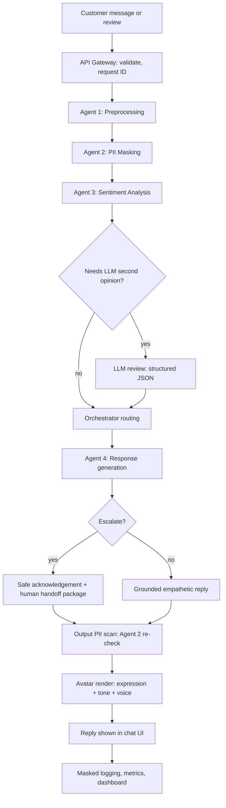

# Retail Customer Sentiment Analysis Chatbot: 4-Agent Architecture Plan

**TCS Technology Day: Problem Statement: Retail Customer Sentiment Analysis Chatbot**

This document defines the architecture for the four agents, the orchestrator that connects them, the data flow, privacy design, models, evaluation, and the build plan. It is based on the problem statement (PS), our team plan, and the reference architecture docx.

---

## 1. Purpose and Scope

### 1.1 What the PS asks for
- A chatbot that **engages customers**, **detects sentiment in real time**, and **generates contextually appropriate empathetic responses or recommends escalation**.
- Success metric: **80%+ sentiment classification accuracy** (the photo of the PS is cut off after this point, so confirm the remaining metrics).
- Deliverables:
  - A simple chat interface
  - Documentation on the sentiment model and integration
  - A demo video showing various customer sentiment scenarios
- Data considerations:
  - Customer feedback text with sentiment labels (public or synthetic)
  - Retail product and service metadata for context
  - Preprocessing to clean text and **balance sentiment classes**
  - **Compliance via anonymization**
  - Data quality and relevance to the problem

### 1.2 Our plan
Customer review/message → preprocess → **hide sensitive data** → analyse sentiment → **generate an avatar** matched to the customer's sentiment, all done by cooperating agents.

### 1.3 Our differentiators
1. **Privacy by design**: a dedicated PII masking agent sits between preprocessing and every model call.
2. **Sentiment-adaptive avatar**: the avatar's expression, tone, and voice adapt to the detected sentiment and emotion.
3. **Two-tier sentiment analysis**: a fast classifier on every message, with an LLM second opinion only for hard cases.
4. **Explainable escalation**: rule-based triggers combined with model confidence.

### 1.4 The four agents (assumption, please confirm)

| # | Agent | One-line job |
|---|---|---|
| 1 | **Preprocessing Agent** | Safely clean and normalize incoming text without destroying sentiment signal. |
| 2 | **Privacy (PII Masking) Agent** | Detect and mask sensitive data before any model sees it, and re-check outputs. |
| 3 | **Sentiment Analysis Agent** | Classify sentiment, emotion, intent/topic, urgency, and confidence. |
| 4 | **Response, Escalation & Avatar Agent** | Generate the empathetic reply, decide escalation, and drive the avatar. |

An **Orchestrator** (not counted as an agent) coordinates them. If your team defines the four agents differently, for example with Response and Avatar as separate agents, the design below still applies. Only the box boundaries in Section 7 change.

---

## 2. High-Level Architecture

```
┌──────────────────────────────────────────────────────────────┐
│  CLIENT: React chat UI + avatar panel + sentiment dashboard  │
└──────────────────────────────┬───────────────────────────────┘
                               │ REST / WebSocket
┌──────────────────────────────▼───────────────────────────────┐
│  API GATEWAY (FastAPI): validation, auth, rate limit,        │
│  request ID, size limits                                     │
└──────────────────────────────┬───────────────────────────────┘
                               │
┌──────────────────────────────▼───────────────────────────────┐
│  ORCHESTRATOR (LangGraph / state machine)                    │
│  shared state · routing · retries · timeouts · tracing       │
└───┬───────────────┬───────────────┬───────────────┬──────────┘
    │               │               │               │
    ▼               ▼               ▼               ▼
┌─────────┐   ┌───────────┐   ┌───────────┐   ┌─────────────────┐
│ AGENT 1 │ → │  AGENT 2  │ → │  AGENT 3  │ → │     AGENT 4     │
│ Pre-    │   │  Privacy  │   │ Sentiment │   │ Response +      │
│ process │   │  (PII)    │   │ Analysis  │   │ Escalation +    │
│         │   │           │   │           │   │ Avatar          │
└─────────┘   └─────┬─────┘   └─────┬─────┘   └────────┬────────┘
                    │               │                  │
                    ▼               ▼                  ▼
             ┌────────────┐  ┌─────────────┐   ┌──────────────┐
             │ Secure PII │  │ Classifier, │   │ LLM, policy  │
             │ vault      │  │ emotion     │   │ KB (RAG),    │
             │ (encrypted)│  │ model, LLM  │   │ TTS/avatar   │
             └────────────┘  └─────────────┘   └──────────────┘
                               │
┌──────────────────────────────▼───────────────────────────────┐
│  DATA + OBSERVABILITY: SQLite, masked logs,                  │
│  traces, metrics, evaluation harness                         │
└──────────────────────────────────────────────────────────────┘
```

### 2.1 Pipeline flow (Mermaid)



### 2.2 Two operating modes
| Mode | Input | Behaviour |
|---|---|---|
| **Live chat** (primary, demo focus) | One message at a time | Full pipeline, replies in near real time, avatar active. |
| **Batch reviews** (secondary) | CSV or JSON of reviews | Agents 1 to 3 run in bulk, results feed the dashboard, no avatar. Agent 4 drafts replies for negative reviews only. |

---

## 3. Orchestrator

### 3.1 Responsibilities
- Create a **request/correlation ID** and shared **workflow state** per message.
- Call agents in order, validate their structured outputs against schemas, and handle failures.
- Apply **conditional routing** (for example, skip tier 2 for confident positive results).
- Enforce **timeouts, bounded retries, and call caps** so there are no loops.
- Make sure **only masked text** is ever passed beyond Agent 2.
- Record traces and decisions.

### 3.2 Shared state (typed)

```python
class WorkflowState(TypedDict):
    request_id: str
    timestamp: str
    channel: Literal["chat", "review", "survey"]
    raw_text: str                 # exists only until Agent 2 finishes; never logged
    clean_text: str               # output of Agent 1
    masked_text: str              # output of Agent 2; the only text models see
    pii_summary: dict             # counts by entity type, no values
    vault_ref: str | None         # pointer to encrypted placeholder map
    recent_turns: list[str]       # masked last 3 to 5 turns
    sentiment: dict               # Agent 3 output (see 6.5)
    route: str                    # chosen path
    evidence: list[dict]          # optional RAG snippets
    response: dict                # Agent 4 output (see 7.6)
    escalation: dict              # decision, reason, priority
    avatar: dict                  # expression, tone, speed
    errors: list[str]
    metrics: dict                 # latency per step, model used, cost
```

### 3.3 Routing logic

| Condition | Path |
|---|---|
| Positive, high confidence | 1 → 2 → 3 → 4 (fast LLM, short reply) → avatar |
| Neutral information request | 1 → 2 → 3 → 4 with policy RAG → avatar |
| Negative, routine | 1 → 2 → 3 (+ tier 2 if flagged) → 4 empathetic reply with next steps |
| Negative with escalation triggers | 1 → 2 → 3 (+ tier 2) → 4 safe acknowledgement + human handoff |
| Low confidence or conflicting signals | Tier 2 LLM check, then clarifying question, then escalate if still uncertain |
| PII detection fails or the vault is unavailable | **Fail closed**: do not call any external model, return a safe generic reply and log the error |
| Model or provider timeout | Fall back to a simpler path (rule-based or local model) and mark the result as degraded |

### 3.4 Failure and safety rules
- **Fail closed on privacy**: if Agent 2 errors, nothing proceeds to an external model.
- Bounded retries (maximum 2 per step) and a total time budget per request.
- Schema validation on every agent output. Malformed output leads to retry, then fallback.
- Treat user text and retrieved documents as **untrusted** to guard against prompt injection. They can never override system rules.
- No consequential actions (refunds, credits, account changes) are executed. They are only **recommended** to a human.

---

## 4. Agent 1: Preprocessing Agent

### 4.1 Purpose
Turn raw input into clean text **without destroying sentiment signal**. It runs before PII masking, so it must stay non-destructive: do not lowercase or strip characters that PII patterns rely on.

### 4.2 Inputs and outputs

| | Details |
|---|---|
| **Input** | `raw_text`, channel, optional locale |
| **Output** | `clean_text`, language code, flags (empty, too long, duplicate, non-text), preprocessing report |

### 4.3 Steps (online, per message)
1. Reject empty or oversize input (set a character cap, for example 2,000 characters for chat).
2. Fix encoding issues, normalize Unicode, and strip control characters.
3. Remove HTML tags and markup artifacts (relevant for scraped reviews).
4. Collapse repeated whitespace and trim.
5. Detect language. Flag non-English or code-mixed text (for example Hinglish) for routing.
6. Detect exact or near duplicate reviews (batch mode).
7. Optionally normalize obvious noise like elongated words ("sooooo bad" → "soo bad") while still preserving emphasis.

### 4.4 What this agent must NOT do
- Do not lowercase everything (CAPS can signal anger and the Cardiff model is cased).
- Do not remove stopwords, especially negations ("not", "never", "no").
- Do not strip emojis, "!!!", or "???".
- Do not stem or lemmatize for transformer models.
- Do not remove digits yet. The PII agent needs them.

### 4.5 Offline data-preparation pipeline (training and evaluation only)
Separate from the live agent, but part of the PS "data considerations":
1. Collect public review datasets (for example Amazon or Yelp reviews) and generate **synthetic** retail chat messages.
2. Map labels. Star ratings can be used as weak labels, but hand-verify at least a few hundred test examples because 3-star reviews are noisy.
3. Clean and deduplicate.
4. **Balance classes** in the training set (class weights, oversampling, or downsampling). Keep the **test set at natural distribution**.
5. Run the PII masking agent over the dataset so training and testing text includes placeholders.
6. Split into train, validation, and test, and freeze the test set.
7. Attach retail metadata (product category, order type) where useful for context.
8. Produce a **data quality report**: class counts, length stats, duplicates removed, label-noise audit.

### 4.6 Failure modes
| Failure | Handling |
|---|---|
| Empty or whitespace-only | Return a polite "please type your message" reply |
| Extremely long input | Truncate with a flag, or ask for a shorter message |
| Unsupported language | Route to the multilingual model, or reply that the language is limited |
| Garbled encoding | Best-effort fix, flag if still unreadable |

### 4.7 Tests
- Unit tests for each cleaning step, including cases that must stay unchanged (emojis, caps, negations).
- Round-trip test confirming no PII-relevant characters were altered.

---

## 5. Agent 2: Privacy (PII Masking) Agent

### 5.1 Purpose
Ensure **no raw sensitive data reaches any model, log, or trace**, and that responses do not leak data either. This is our main differentiator, so it is designed as a layered and testable system, not a single prompt.

### 5.2 Position in the pipeline
```
raw → [Agent 1: light cleanup] → [Agent 2: MASK] → everything else sees masked text only
                                      ↑
                         [Agent 2: OUTPUT SCAN] ← response from Agent 4
```

### 5.3 Entities to detect

| Category | Examples | Method |
|---|---|---|
| Contact | Email, phone (+91 and 10-digit mobile), address | Regex, NER |
| Identity | Person names, date of birth | NER, patterns |
| Government IDs | Aadhaar (12 digits), PAN (`AAAAA9999A`) | Regex plus checksum where possible |
| Financial | Card numbers (Luhn check), UPI IDs, bank account, IFSC | Regex plus validation |
| Retail identifiers | Order ID, tracking number, customer or loyalty ID | Custom regex per company format |
| Location | Locality, city (when tied to an individual), PIN code | NER, context rules |
| Technical | IP address, device ID | Regex |
| Contextual leaks | "my husband Ravi bought it", "I work at X" | NER, optional local LLM check |

### 5.4 Layered detection

1. **Layer 1, rules (regex and validators)**: fast and precise for structured formats. Includes checksum validation (Luhn for cards) to reduce false positives.
2. **Layer 2, NER**: Microsoft Presidio with spaCy (or a Hugging Face NER model) for names, locations, and organizations. Add **custom recognizers** for Indian formats.
3. **Layer 3, optional contextual check**: a **local** small model, or an LLM that only sees text already masked by layers 1 and 2. Never send unmasked text to an external LLM for detection.
4. **Allow-list**: avoid masking harmless terms (brand and product names, store names) via an allow-list to reduce false positives.

### 5.5 Masking strategy
Replace values with **typed, numbered placeholders** so sentiment and context are preserved:

| Raw | Masked |
|---|---|
| Priya Sharma | `[PERSON_1]` |
| 98450 12345 | `[PHONE_1]` |
| priya.s@gmail.com | `[EMAIL_1]` |
| Order #84521 | `[ORDER_ID_1]` |
| 4111 1111 1111 1111 | `[CARD_1]` |

Example:
> **Input:** "Hi, I'm Priya Sharma, my order #84521 hasn't arrived. Call me on 98450 12345. I'm really angry!"
> **Masked:** "Hi, I'm [PERSON_1], my order [ORDER_ID_1] hasn't arrived. Call me on [PHONE_1]. I'm really angry!"

Numbering keeps consistency (the same person is always `[PERSON_1]`).

### 5.6 Secure vault
- The placeholder-to-value mapping is stored **encrypted**, separate from the conversation store, with a short TTL and access limited to the human handoff step.
- **Never sent to any model.** Models only ever see placeholders.
- Deleted when the session ends or on retention expiry.
- For the hackathon: an encrypted in-memory or SQLite store with a key from environment variables. Document the production approach (KMS-managed keys).

### 5.7 Output scan (second pass)
Agent 4's response is scanned again before it is shown or logged:
- Detect any raw PII-looking strings (the model might hallucinate or echo).
- Replace placeholders with real values **only if required and allowed** (for example, addressing the customer by first name in the chat UI where the customer already provided it). By default, do not re-insert.
- Block responses that contain card numbers, government IDs, or other high-risk entities.

### 5.8 Customer-facing privacy behaviour
- If a customer pastes a card number or an Aadhaar number, the chatbot responds with a **gentle warning** ("For your safety, please don't share card or ID numbers in chat") while still handling the complaint.
- A visible privacy indicator in the UI shows that sensitive data was masked.

### 5.9 Outputs

```json
{
  "masked_text": "...",
  "entities_found": {"PERSON": 1, "PHONE": 1, "ORDER_ID": 1},
  "vault_ref": "v_8f3a...",
  "risk_level": "low | medium | high",
  "detector_confidence": 0.93
}
```
The report holds **counts only**, never the values.

### 5.10 Evaluation
- Build a synthetic PII test set with known entities (Indian and generic formats, plus misspelled and spaced-out variants).
- Report **precision and recall per entity type**. **Recall matters most**, since a missed entity is a leak.
- Report false positive rate (over-masking that harms sentiment accuracy).
- Measure the effect: **sentiment accuracy on masked text vs raw text**. It should be nearly equal.
- Demo UI: a **before/after panel** showing raw input vs what the models receive.

### 5.11 Known limitations (state honestly in documentation)
- No detector is 100% accurate. We reduce risk, we do not eliminate it.
- Obfuscated data ("nine eight four five...") and unusual formats are harder to catch.
- Names that are also common words can be missed or over-masked.
- Multilingual and code-mixed text lowers NER accuracy.

---

## 6. Agent 3: Sentiment Analysis Agent

### 6.1 Purpose
Convert **masked** text into structured, actionable signals: sentiment polarity, emotion, intent/topic, urgency, escalation signals, and confidence.

### 6.2 Inputs and outputs

| | Details |
|---|---|
| **Input** | `masked_text`, last 3 to 5 masked turns, channel, optional metadata (product category, order value tier) |
| **Output** | Structured sentiment object (see 6.5) |

### 6.3 Two-tier design

**Tier 1, runs on every message (fast, cheap)**
- **Polarity model**: `cardiffnlp/twitter-roberta-base-sentiment-latest` (3-class: negative, neutral, positive). Use `cardiffnlp/twitter-xlm-roberta-base-sentiment` if multilingual input matters.
- **Emotion model**: `j-hartmann/emotion-english-distilroberta-base` (anger, disgust, fear, joy, neutral, sadness, surprise) to get frustration and anger as separate signals.
- **Rule layer** (retail escalation signals): keywords and patterns such as "refund", "cancel", "chargeback", "consumer court", "fraud", "worst", plus repeated contact on the same order and caps/exclamation intensity.
- **Intent/topic classification**: delivery, refund/return, product quality, pricing, payment, warranty, service/staff, information request, praise. Start with zero-shot or an LLM-assigned label and move to a small classifier if time allows.

**Tier 2, runs only when needed (smart, slower)**
Trigger the LLM second opinion when any of these hold:
- Predicted negative sentiment (we want to be careful with unhappy customers)
- Confidence below a threshold (start at 0.70 and tune on validation data)
- Polarity and emotion models disagree
- Sentiment dropped by one level or more across the last 3 turns
- Possible sarcasm or mixed sentiment indicators ("great, another delay")
- Message is very short and ambiguous ("Fine.")

The LLM receives **masked text only** and returns validated structured JSON with a short reason. The trigger rate is logged so we can report cost and latency.

### 6.4 Conversation-level signals
- Score the **last few turns**, not only the latest message.
- Track **sentiment trend** across the conversation. A steady decline is a stronger escalation signal than one negative message.
- Count repeat contacts about the same (masked) order or issue.

### 6.5 Output schema

```json
{
  "polarity": "negative",
  "polarity_scores": {"negative": 0.91, "neutral": 0.08, "positive": 0.01},
  "emotion": "anger",
  "emotion_scores": {"anger": 0.72, "sadness": 0.10},
  "intent": "delivery_delay",
  "topic": "delivery",
  "urgency": "high",
  "confidence": 0.88,
  "trend": "declining",
  "escalation_signals": ["repeat_contact", "refund_keyword"],
  "tier_used": 2,
  "reason": "Customer reports a repeated delay and expresses frustration.",
  "evidence_spans": ["hasn't arrived", "really angry"]
}
```

### 6.6 Urgency scoring (rule plus model)
Combine emotion intensity, escalation keywords, repeated contacts, trend, and optional order value tier into a simple, **explainable** urgency level (low, medium, high, critical), and expose which signals contributed.

### 6.7 Model selection and fine-tuning decision
1. Evaluate off-the-shelf models on a **held-out, masked, 3-class test set**.
2. Compare baselines: VADER (floor), DistilBERT (speed), RoBERTa-based (main), nlptown or siebert (review comparison).
3. **Fine-tune RoBERTa-base only if** macro-F1 or neutral-class recall misses the target. Use class-balanced training data.
4. Report accuracy, macro-F1, per-class precision and recall, and a confusion matrix on both **review** and **chat-style** test sets.

### 6.8 Failure modes

| Failure | Handling |
|---|---|
| Model load or inference error | Fall back to VADER plus rules, mark `degraded: true` |
| Low confidence | Trigger tier 2, then ask a clarifying question or escalate |
| LLM invalid JSON | Retry once, then use tier 1 result with a lower confidence flag |
| Non-English text | Use the multilingual model or the LLM tier |
| Sarcasm | Rely on tier 2 and log for review |

---

## 7. Agent 4: Response, Escalation & Avatar Agent

### 7.1 Purpose
Turn the analysis into a **safe, empathetic, grounded reply**, decide **whether a human must take over**, and **drive the avatar** so its expression and voice match the customer's emotional state.

This agent has three internal modules: **Response Generator**, **Escalation Decision**, and **Avatar Controller**.

### 7.2 Inputs and outputs

| | Details |
|---|---|
| **Input** | `masked_text`, sentiment object, recent masked turns, optional policy evidence (RAG), business rules |
| **Output** | Reply text, escalation decision, handoff package, avatar directives, citations |

### 7.3 Module A: Response Generator

**Behaviour**
- Acknowledge the specific issue and emotion first, and offer help or next steps second.
- Ground factual statements (returns, warranty, delivery policy) in retrieved or approved policy text. If no evidence exists, **ask or escalate instead of inventing policy**.
- Match tone to emotion (see 7.5).
- Never promise refunds, credits, or exceptions. Explain the policy and say a human will confirm.
- Use only masked context. Do not ask the customer to share sensitive data.

**Model choice (lightweight model gateway)**
| Situation | Model |
|---|---|
| Simple FAQ, praise, short acknowledgement | Fast, small LLM |
| Nuanced complaint, multi-turn, sarcasm | Stronger LLM |
| Provider timeout | Fallback model, then a template reply |

**Prompt design**
- System prompt: role, tone rules, the "never promise" rule, grounding rule, output JSON schema.
- Provide: masked message, sentiment summary, policy snippets, and a strict instruction to treat customer text as data, not instructions.
- Structured output, validated by schema: `reply`, `next_steps`, `citations`, `confidence`.

**Optional lightweight RAG (if time permits)**
- Knowledge base: synthetic retail policies (returns, warranty, delivery, refunds, FAQ) and product metadata.
- Hybrid retrieval (vector plus keyword), with source IDs attached to the answer.
- If nothing relevant is retrieved, do not invent. Ask a clarifying question or escalate.
- Stack: a local vector store (FAISS or Chroma) plus SQLite FTS5 for keyword matching.

**Validation before sending**
- Schema check, grounding check (claims supported by evidence), tone check, no unauthorized promises, no PII (Agent 2 output scan).

### 7.4 Module B: Escalation Decision

**Rule-based decision with explainable triggers**

| Trigger | Action |
|---|---|
| Negative sentiment and high or critical urgency | Escalate, priority high |
| Repeated unresolved complaint (2 or more contacts on the same issue) | Escalate, priority high |
| Declining sentiment trend across turns | Escalate or flag for follow-up |
| Keywords: chargeback, legal, consumer court, fraud, safety, injury | Escalate immediately, priority critical |
| Refund, credit, or exception request | Explain policy, recommend human approval |
| Low confidence after tier 2, or no supporting evidence | Clarify, then escalate |
| Customer explicitly asks for a human | Escalate immediately |
| Positive or neutral and confident | No escalation |

**Escalation levels**
`none` → `follow_up_flag` → `human_review` → `urgent_human_handoff`

**What the customer sees:** a safe acknowledgement ("I'm sorry about this. I'm passing your case to our support team so they can help you directly") and no unapproved promises.

**Handoff package (for the human agent)**
- Case summary (masked)
- Sentiment, emotion, urgency, and trend
- Relevant masked excerpts
- Policy references retrieved
- Reason for escalation and priority
- Vault reference (so an authorized human can retrieve contact details if permitted)
- No unnecessary personal data

### 7.5 Module C: Avatar Controller

**Purpose:** make the interaction feel human and empathetic by adapting the avatar to the customer's sentiment and emotion.

**Mapping table (initial design)**

| Customer state | Avatar expression | Voice and tone | Pace | Reply style |
|---|---|---|---|---|
| Positive / joy | Warm smile, bright | Friendly, upbeat | Normal | Appreciative, brief |
| Neutral / information | Attentive, relaxed | Clear, professional | Normal | Concise and factual |
| Negative / frustrated | Concerned, calm, soft eyebrows | Calm, apologetic, steady | Slower | Acknowledge, apologize, give next steps |
| Angry / high urgency | Serious, attentive, no smile | Calm and respectful | Slower | De-escalate, reassure, hand off quickly |
| Sad / disappointed | Gentle, empathetic | Soft, warm | Slower | Compassionate, supportive |
| Anxious / confused | Reassuring, open | Clear, patient | Normal | Step-by-step guidance |
| Escalated case | Composed, reassuring | Calm | Slower | Safe acknowledgement of handoff |

**Design rules**
- Never show a cheerful smile to a clearly angry customer. Mismatched affect makes things worse.
- Keep expression changes smooth (no jumping between extremes on a single uncertain prediction). Use confidence and trend to smooth transitions.
- If sentiment confidence is low, default to a **neutral attentive** expression.

**Avatar directive (output)**
```json
{
  "expression": "concerned",
  "intensity": 0.7,
  "voice_tone": "calm_apologetic",
  "speech_rate": 0.9,
  "gesture": "slight_nod",
  "caption": "I'm sorry about the delay..."
}
```

**Implementation options (start simple, upgrade if time allows)**

| Option | Effort | Notes |
|---|---|---|
| 2D SVG or CSS avatar with swappable expressions (or Lottie animations) | Low | Reliable and fast. **Recommended for MVP.** |
| Web Speech API (browser text-to-speech) for voice | Low | Free, local. Adjust pitch and rate by tone. |
| 3D avatar (Three.js / Ready Player Me style) with blendshapes | Medium to high | Nicer demo, more risk. |
| Third-party talking-head or TTS APIs | Medium | Sends reply text externally. Only masked, approved reply text may leave. Check terms first. |

Privacy note: only the **final, output-scanned reply text** may be sent to any TTS or avatar service.

### 7.6 Output schema

```json
{
  "reply": "I'm really sorry your order is delayed...",
  "next_steps": ["Check order status", "Connect with support"],
  "citations": ["policy_delivery_v2#section3"],
  "escalation": {
    "decision": "human_review",
    "priority": "high",
    "reason": "negative sentiment, repeat contact, high urgency"
  },
  "avatar": {"expression": "concerned", "voice_tone": "calm_apologetic", "speech_rate": 0.9},
  "handoff_package": {"summary": "...", "signals": ["..."]},
  "confidence": 0.84
}
```

### 7.7 Failure modes

| Failure | Handling |
|---|---|
| LLM timeout or error | Fallback model, then a pre-approved template reply per sentiment |
| Ungrounded or hallucinated policy claim | Block, regenerate once, then ask or escalate |
| Output contains PII | Block or re-mask via Agent 2 |
| Avatar asset fails to load | Fall back to text-only reply and a static avatar |
| TTS unavailable | Show captions only |

---

## 8. Supporting Components

### 8.1 Lightweight model gateway
- Single interface to the LLM provider(s) (OpenAI, Anthropic, Gemini, or a local model), depending on available credentials.
- Task-to-model routing (fast vs strong), timeouts, bounded retries, fallbacks.
- Structured-output validation and token/cost logging.
- Only masked text goes through it.

### 8.2 Memory (keep it minimal for the hackathon)
- **Working memory:** current session state and the last 3 to 5 masked turns, kept in the orchestrator state and the SQLite `messages` table (no Redis needed).
- **Case history (optional):** store masked conversation summaries and escalation outcomes in the database, keyed by an internal session ID.
- No long-term storage of raw personal data. Include a retention window and a delete endpoint in the design.

### 8.3 Knowledge base (optional RAG)
- Synthetic policy and product documents with versions and metadata.
- Used by Agent 4 to ground answers.

### 8.4 Observability
- Trace each request across agents with the correlation ID.
- Log latency per step, model used, token cost, tier-2 trigger rate, escalation decisions, and errors.
- **All logs contain masked text only.**
- Tools: Langfuse or OpenTelemetry (optional), or simple structured logging for the MVP.

---

## 9. Data Plan

| Item | Plan |
|---|---|
| Sentiment-labelled text | Public datasets (Amazon or Yelp reviews, plus any dataset provided by the PS) and synthetic retail chats generated by an LLM from templates (delivery, refund, quality, praise) |
| Labels | Positive, neutral, negative (plus emotion and intent labels where available). Hand-verify a few hundred test examples. |
| Class balance | Balance training data (class weights or resampling). Keep the test set natural. |
| Retail metadata | Synthetic product catalog (category, price tier) and policy documents |
| Privacy | Use anonymized or synthetic data. Run all data through Agent 2 before use. Document the compliance approach. |
| Data quality | Deduplicate, check label noise, and report statistics |
| PII test set | Separate synthetic set with planted PII for Agent 2 evaluation |

---

## 10. Technology Stack

| Layer | Choice |
|---|---|
| Frontend | React + Vite + Tailwind CSS (chat UI, avatar panel, masking before/after panel, sentiment dashboard) |
| Backend | Python + FastAPI |
| Orchestration | LangGraph (`StateGraph`, conditional edges, SQLite checkpointer, see 10.1) |
| Preprocessing | Python (`ftfy`, `langdetect` or `fastText`, regex) |
| PII | Microsoft Presidio, spaCy, custom regex recognizers |
| Sentiment | Hugging Face Transformers (Cardiff RoBERTa, emotion DistilRoBERTa), VADER baseline |
| LLM | One provider through the gateway (OpenAI, Anthropic, or Gemini) |
| RAG (optional) | FAISS or Chroma (local vector index) + SQLite FTS5 for keyword search |
| Avatar | SVG/CSS or Lottie avatar, Web Speech API |
| Storage | SQLite (via SQLAlchemy, WAL mode); encrypted vault table |
| Monitoring | Structured logs, Langfuse or OpenTelemetry (optional) |
| Deployment | Docker Compose for the demo |


### 10.1 Stack-specific notes (React, Python, SQLite, LangGraph)

**LangGraph**
- Each agent is a graph **node**. Routing (skip tier 2, escalate, fail closed) uses **conditional edges**.
- **Checkpointer warning:** if you use `SqliteSaver` for session persistence, it saves the whole state after every node, including `raw_text`. Either do the cleanup and masking inside a single node and drop `raw_text` from the returned state, or keep raw text out of the checkpointed state entirely. Otherwise raw PII ends up in the database and defeats Agent 2.
- Set a recursion limit and per-node timeouts.

**SQLite**
- Enable WAL mode and use one connection per request (FastAPI is concurrent).
- Suggested tables:

| Table | Contents |
|---|---|
| `sessions` | session ID, channel, created time, retention expiry |
| `messages` | session ID, turn number, **masked** text, sentiment JSON, timestamp |
| `cases` | escalation ID, priority, reason, status, masked summary |
| `pii_vault` | vault ref, **encrypted** placeholder map, TTL |
| `pii_audit` | request ID, entity counts by type (no values) |
| `metrics` | request ID, latency per step, model used, tier used, cost |
| `kb_chunks` (optional) | policy text chunks, source ID, version, FTS5 index |

- Store the vault in a separate database file from `messages`, so a leak of one does not expose the other.
- SQLite is fine for a demo. Note in the documentation that production would move to PostgreSQL.

**React**
- Chat via WebSocket or streaming (SSE) so the reply appears as it is generated.
- Components: `ChatWindow`, `AvatarPanel`, `PrivacyPanel` (raw vs masked), `SentimentBadge`, `EscalationBanner`, `Dashboard` (charts with Recharts).
- Do the avatar with SVG or Lottie and the browser Web Speech API.
- Never store raw message text in `localStorage`.

**Python and FastAPI**
- Load the Hugging Face models once at startup, not per request.
- Run model inference off the event loop (thread pool) so chat stays responsive.
- Pydantic models for every agent's input and output schema.

---

## 11. API Design

| Endpoint | Purpose |
|---|---|
| `POST /chat` | Single message in, full pipeline, returns reply, sentiment, avatar directives, escalation |
| `POST /reviews/batch` | Upload reviews, run Agents 1 to 3, return aggregated sentiment |
| `GET /dashboard/summary` | Sentiment distribution, trends, escalation counts, tier-2 rate |
| `GET /cases/{id}` | Escalated case view (masked) |
| `POST /privacy/preview` | Demo endpoint showing raw vs masked text |
| `DELETE /session/{id}` | Delete session data and vault entries |
| `GET /health` | Health and model status |

---

## 12. Suggested Project Structure

```
app/
  api/
    routes_chat.py
    routes_reviews.py
    routes_dashboard.py
    routes_privacy.py
  orchestration/
    graph.py              # workflow graph
    state.py              # WorkflowState
    router.py             # routing rules
    policies.py           # escalation and safety rules
  agents/
    preprocess_agent.py   # Agent 1
    privacy_agent.py      # Agent 2
    sentiment_agent.py    # Agent 3
    response_agent.py     # Agent 4: response module
    escalation.py         # Agent 4: escalation module
    avatar_controller.py  # Agent 4: avatar module
  privacy/
    recognizers_india.py  # Aadhaar, PAN, UPI, +91 phone, IFSC
    masker.py
    vault.py
    output_scan.py
  sentiment/
    polarity_model.py
    emotion_model.py
    rules.py              # escalation keywords, urgency
    llm_review.py         # tier 2
  model_gateway/
    router.py
    providers.py
    schemas.py
    fallback.py
  retrieval/               # optional RAG
    ingestion.py
    hybrid_search.py
  data/
    database.py
    repositories.py
  observability/
    tracing.py
    metrics.py
    evaluation.py
frontend/
  src/components/ChatWindow, AvatarPanel, PrivacyPanel, Dashboard
data/
  synthetic/ , eval/ , policies/
tests/
docs/
```

---

## 13. Security and Privacy Summary

- Mask before every model call, log, and trace. **Fail closed** if masking fails.
- Output scan on every response.
- Encrypted vault with a short TTL for the placeholder map. Never sent to models.
- Authentication, input validation, size limits, and rate limiting at the API boundary.
- Prompt-injection defence: user and retrieved text is data, never instructions. Tool allow-list and no autonomous consequential actions.
- Minimal data retention with a delete endpoint.
- No automatic training on customer data without governance.
- Secrets in environment variables and never in logs.

---

## 14. Evaluation Plan and Success Metrics

| Metric | Target / method |
|---|---|
| **Sentiment accuracy (3-class)** | **80%+ (PS target)**, measured on a held-out, masked test set. Do not claim it until measured. |
| Macro-F1, per-class recall (especially neutral) | Report with a confusion matrix, on review and chat test sets |
| Emotion and intent accuracy | Evaluated on a small labelled sample |
| PII detection | Precision and recall per entity type. Recall is the priority. |
| Masking impact | Sentiment accuracy on masked vs raw text |
| Escalation precision and recall | Test on scripted scenarios, tuned with manual review |
| Response quality | Rubric review of a sample (empathy, relevance, grounding, no false promises) |
| Grounded response rate | Share of factual claims supported by policy sources |
| Latency | p50 and p95 per step and end to end |
| Tier-2 trigger rate and cost per interaction | Logged and reported |
| Avatar appropriateness | Manual check of the expression vs emotion mapping |

---

## 15. Deliverables Checklist (from the PS)

| PS deliverable | Our plan |
|---|---|
| Simple chat interface | React chat UI with avatar panel, privacy before/after panel, and sentiment indicators |
| Documentation on sentiment model and integration | This plan plus model comparison results, data preparation notes, API docs, and the privacy design |
| Demo video of various sentiment scenarios | Scripted scenarios (below) |
| 80%+ sentiment classification accuracy | Evaluation report with the confusion matrix |
| GenAI capabilities: sentiment analysis and conversational response generation | Agents 3 and 4 |
| Anonymization and compliance | Agent 2 plus the evaluation report |

### Demo video scenarios
1. **Happy customer:** praise for a product. Smiling avatar, short appreciative reply.
2. **Neutral question:** a return-policy question. Attentive avatar, grounded answer with a policy citation.
3. **Frustrated customer:** a delayed order. Concerned avatar, empathetic reply with next steps.
4. **Angry repeat complaint:** unresolved issue, refund keyword. Calm avatar, **escalation** with a handoff summary.
5. **Sensitive data scenario:** the customer pastes a phone number, order ID, and card number. The **before/after masking panel** is shown, with a privacy warning.
6. **Sarcasm or ambiguity:** "Great, another delay." Tier-2 LLM review catches it.
7. **Dashboard view:** sentiment distribution, trend, and escalation counts.

---

## 16. Implementation Roadmap

| Phase | Build | Done when |
|---|---|---|
| 1. Foundation | FastAPI, React chat UI, state schema, basic orchestrator, Agent 1 | A message flows through cleanup and returns a placeholder reply |
| 2. Privacy | Agent 2 with regex, Presidio, Indian recognizers, vault, output scan, PII test set | Recall and precision measured, before/after panel working |
| 3. Sentiment | Agent 3 tier 1 (polarity, emotion, rules), baseline comparison, tier 2 LLM | Accuracy and macro-F1 reported on the masked test set |
| 4. Response and escalation | LLM reply generation, validation, escalation rules, handoff package | Scripted scenarios give correct replies and escalation decisions |
| 5. Avatar | SVG/Lottie avatar, expression mapping, TTS | Avatar visibly changes with sentiment, with smoothing |
| 6. Polish and evaluation | Dashboard, optional RAG, fine-tuning if needed, documentation, demo video | All deliverables complete and the evaluation report written |

**Priority if time is short:** Agents 1 to 3 plus a text reply and escalation come first. A simple avatar comes next. RAG, fine-tuning, and the 3D avatar come last.

---

## 17. Risks and Mitigations

| Risk | Mitigation |
|---|---|
| Accuracy below 80% on 3 classes (neutral is hardest) | Test baselines early, fine-tune on balanced data, use the tier-2 LLM for hard cases |
| PII missed by detectors | Layered detection, output scan, honest limitations, high-recall tuning |
| Over-masking hurts sentiment | Measure masked vs raw accuracy, tune the allow-list |
| LLM hallucinated policy or false promises | RAG grounding, validation, "never promise" rule, escalate when unsure |
| Avatar mismatch (smiling at an angry customer) | Mapping rules, confidence smoothing, neutral default |
| Latency too high for real time | Tier-1 on every message, tier-2 only when flagged, fast LLM for simple replies, stream the reply |
| Scope creep (memory, gateway, monitoring) | Build the MVP path first, and document the rest as roadmap |
| Third-party API privacy or cost issues | Send only masked, approved text, keep a local fallback |
| Label noise from star ratings | Hand-verify the test set |
| Non-English or code-mixed input | Multilingual model option, LLM tier, and an explicit limitation note |

---

## 18. Open Questions for the Team

1. Are the four agents as defined in Section 1.4? If not, which boundaries differ?
2. Does the PS provide a dataset, or do we use public and synthetic data?
3. What are the remaining success metrics at the cut-off edge of the PS photo?
4. Which LLM provider and credentials do we have, and are external API calls allowed?
5. What kind of avatar do we want (2D animated, 3D, or voice-only)?
6. Do we need multilingual or Hinglish support?
7. Is batch review analysis required, or is live chat enough for the demo?
8. How will the human handoff be shown (a mock agent console or an alert panel)?
