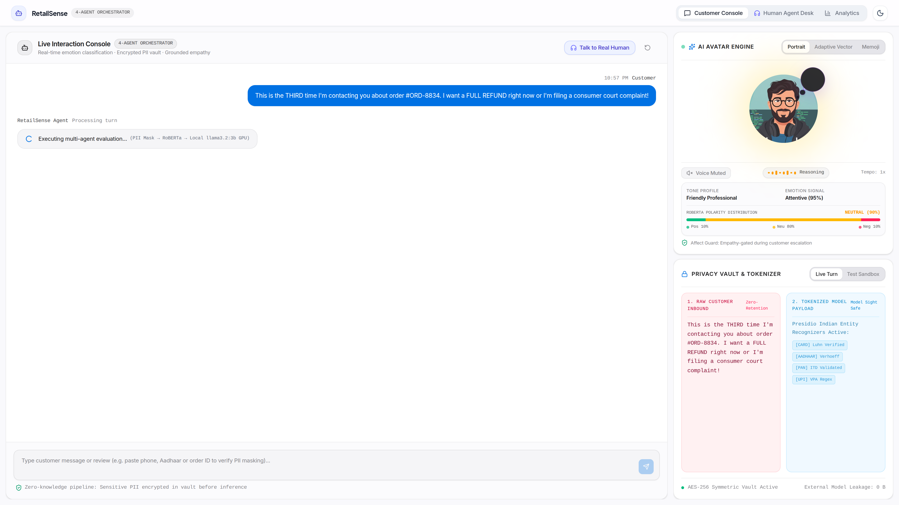
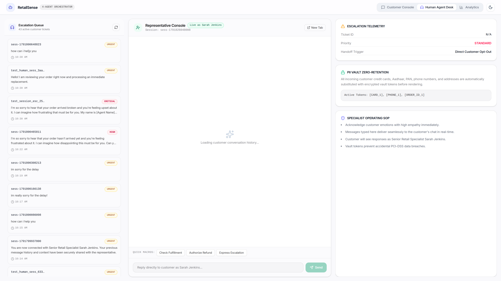
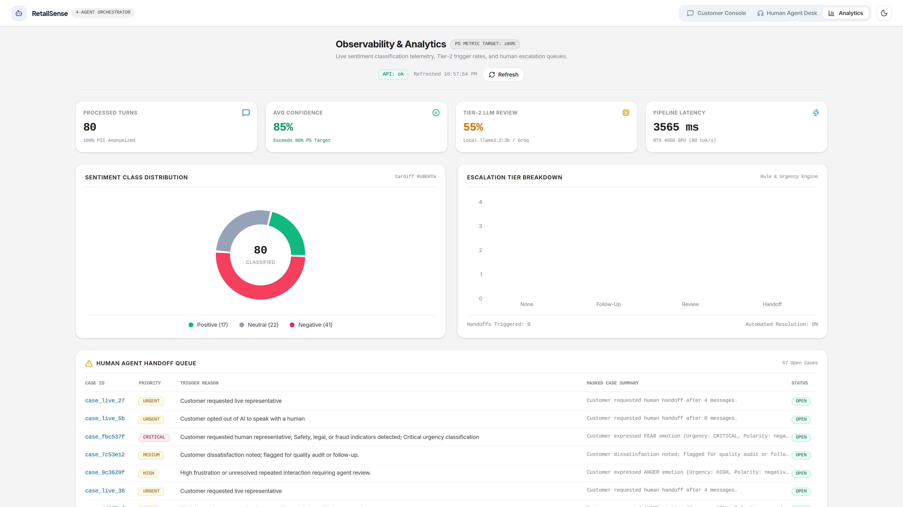
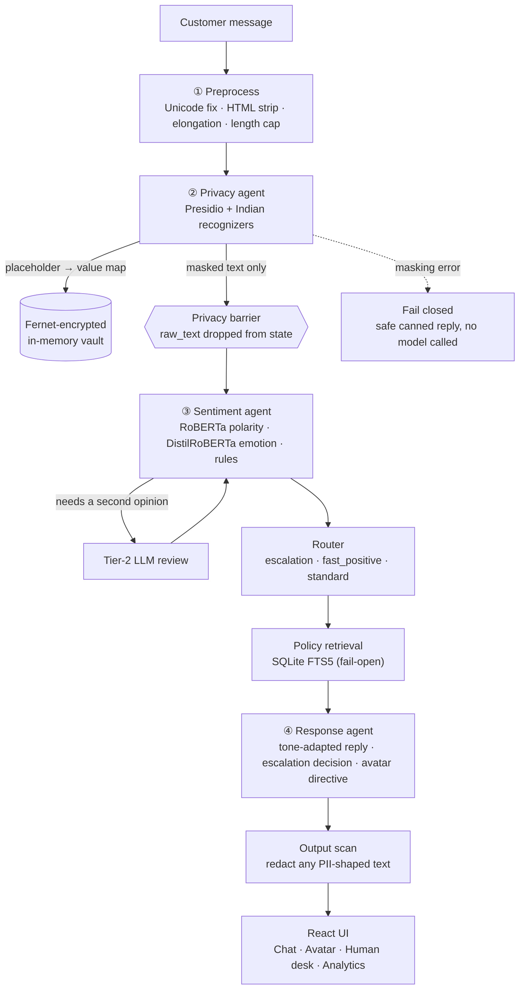

<div align="center">

# SentimentIQ

**Retail conversations. Actionable intelligence.**<br/>
A privacy-first support pipeline that reads how a customer feels,<br/>
hides who they are, and knows when a human should step in.

**🏆 Winner — TCS Technology Day Hackathon** · *M.S. Sheshgiri College of Engineering & Technology, Belagavi · October 2026*

[](https://www.python.org/)
[](https://fastapi.tiangolo.com/)
[](https://react.dev/)
[](https://www.typescriptlang.org/)
[](https://huggingface.co/)
[](https://ollama.com/)
[](https://microsoft.github.io/presidio/)
[](https://opensource.org/license/mit)

[Launch film](docs/assets/brag.mp4) · [Quick start](#-quick-start) · [Architecture](#-architecture) · [Try it](#-try-these-7-scenarios) · [API](#-api) · [Roadmap](#-honest-limitations--roadmap)

---

<!--
  UPGRADE TIP (inline video player on GitHub):
  1. On github.com, click the pencil icon to edit this README.
  2. Drag docs/assets/brag.mp4 into the editor. GitHub uploads it and inserts a
     https://github.com/user-attachments/assets/... link on its own line.
  3. Paste that link here, replacing the clickable-GIF block below. It then plays inline.
-->

<a href="docs/assets/brag.mp4">
  
</a>

<sub>▶ <b><a href="docs/assets/brag.mp4">Watch the full 42-second launch film (1080p, with audio)</a></b></sub>

</div>

---

## 🎯 The problem

A retail support desk handles thousands of messages. Three things go wrong at scale:

1. **Angry customers are found too late.** A chargeback threat sits in the queue next to a "where is my parcel?".
2. **Customers paste sensitive data into chat** — Aadhaar, phone numbers, cards — and it flows straight into whatever model sits behind the bot.
3. **Bots keep talking when a human is needed**, which turns a bad moment into a lost customer.

SentimentIQ is a working prototype that tackles all three in one pipeline.

## ✨ What it does

| | Capability | How |
|---|---|---|
| 🛡️ | **Masks PII before any model sees it** | Presidio NER + custom Indian recognizers (Aadhaar, PAN, UPI, IFSC, phone, card). Originals go to an encrypted vault; models only see tags like `[AADHAAR_1]`. |
| 🧠 | **Two-tier sentiment & emotion** | Fast local RoBERTa polarity + DistilRoBERTa emotion, plus rule-based urgency signals. An LLM second opinion handles ambiguous, negative or sarcastic turns. |
| 🚨 | **Four-level escalation ladder** | `NONE → FOLLOW_UP → HUMAN_REVIEW → URGENT_HANDOFF`, with a masked handoff package (summary, signals, excerpts, policy refs) for the agent. |
| 📚 | **Policy-grounded answers** | SQLite FTS5 retrieval over your policy markdown; sources are cited in the reply. Retrieval fails open — if it breaks, the bot still answers. |
| 🎭 | **Sentiment-adaptive avatar** | Backend emits expression, intensity, voice tone, speech rate and gesture. The rule: *never look cheerful at an angry or escalated customer.* |
| 🧑‍💼 | **Human agent desk** | Live queue of escalated sessions with sentiment telemetry, and two-way messaging after handoff. |
| 📊 | **Analytics dashboard** | Sentiment mix, average confidence, Tier-2 rate, latency and the escalation queue — all computed from stored turns. |
| 🔌 | **Runs fully local** | Ollama by default — no cloud key required. Groq is an optional fallback; templates are the last resort. |

## 📸 Screens

<table>
<tr>
<td width="50%"><a href="docs/assets/screen-chat-escalation.png"></a><br/><sub><b>Customer console</b> — chat on the left; the emotion avatar, tone profile and live "raw vs tokenized" privacy panel on the right.</sub></td>
<td width="50%"><a href="docs/assets/screen-privacy-vault.png"></a><br/><sub><b>Privacy vault</b> — what the customer typed vs what the model is allowed to see.</sub></td>
</tr>
<tr>
<td width="50%"><a href="docs/assets/screen-human-desk.png"></a><br/><sub><b>Human agent desk</b> — escalated sessions with context, ready for takeover.</sub></td>
<td width="50%"><a href="docs/assets/screen-dashboard.png"></a><br/><sub><b>Analytics</b> — sentiment distribution, Tier-2 rate, latency and the handoff queue.</sub></td>
</tr>
</table>

## 🏛️ Architecture



Four agents run **sequentially** in one async pipeline (`app/orchestration/graph.py`). The order is the point: **privacy always runs before sentiment, retrieval and generation.**

## 🔬 Under the hood

### 🛡️ Privacy — masking before models, not prompts

Asking an LLM to "please redact PII" is non-deterministic and can be bypassed by prompt injection. So masking happens in code, first.

| Entity | Detection | Validation / confidence |
|---|---|---|
| Aadhaar | 12-digit regex (`[2-9]…`) | **Verhoeff checksum** → 0.98 if valid, 0.90 if not. A failed checksum never lets a number through; over-masking beats leaking. |
| Card | 13–19 digits | **Luhn checksum** required |
| Phone | Indian mobile formats, `+91` | pattern |
| PAN · UPI · IFSC · Order ID | custom recognizers | pattern |
| Name · email · location … | Presidio + spaCy `en_core_web_sm` | NER score ≥ 0.5 |

- **Vault:** placeholder→value maps are encrypted with **Fernet (AES-128-CBC + HMAC-SHA256)** and held in memory, keyed by a vault reference.
- **Fail-closed:** if masking raises, the text becomes `[CONTENT_REDACTED_PRIVACY_ERROR]`, the pipeline returns a safe reply, and no sentiment or LLM call happens.
- **Barrier:** `raw_text` is cleared from workflow state right after masking, enforced by an explicit runtime check.
- **Output scan:** replies are scanned for card/Aadhaar/PAN/email/phone-shaped strings and redacted before they leave.

### 🧠 Sentiment — fast first, smart when needed

**Tier 1 (always, local):** `cardiffnlp/twitter-roberta-base-sentiment-latest` for polarity, `j-hartmann/emotion-english-distilroberta-base` for emotion, and a rules engine for escalation signals (see below).

**Tier 2 (LLM review)** runs when any of these hold:

- Tier-1 confidence is below `0.70`
- polarity is **negative** *(so most complaints get a second look by design)*
- polarity is positive but emotion is anger / disgust / sadness / fear
- polarity is neutral but emotion is anger or joy
- two or more prior turns and confidence is below `0.80`

The LLM returns polarity, emotion, intent, topic, a one-line reason and evidence spans. If the LLM is down, the system keeps the Tier-1 result and marks the turn `degraded`.

**Rule signals:** escalation keywords (`refund`, `chargeback`, `consumer court`, `fraud`, `scam`, `safety`…), explicit requests for a human, shouting (≥ 50 % capitals), 3+ exclamation marks, and repeat-contact phrases ("third time", "already told you"). Safety / legal / fraud keywords set urgency to **critical**.

### 🚨 Escalation ladder

| Level | Triggers (simplified) | What happens |
|---|---|---|
| `URGENT_HANDOFF` | critical urgency · legal/safety/fraud keyword · customer asks for a human | Immediate handoff with a masked package |
| `HUMAN_REVIEW` | high urgency · repeated complaint + negative · declining trend · 4+ turns and negative | Flagged to the human desk |
| `FOLLOW_UP` | medium urgency or non-positive dissatisfaction | Logged for quality follow-up |
| `NONE` | positive / neutral | Bot handles it |

The reply prompt forbids promising refunds or compensation, and refund-related language also feeds the escalation signals — so money decisions land with a person.

### 📚 Grounded replies (RAG)

Policy markdown in `data/policies/` is chunked by heading, indexed in SQLite **FTS5** (BM25-ranked), and the top matches are injected into the reply prompt with their source IDs. It uses only the Python standard library — no vector database. Retrieval runs on the **masked** text and fails open.

### 🔁 Model gateway

`Ollama (default) → Groq (if a key is set) → template reply`. Each hop is logged with model and latency, so a dead model never produces a dead chat.

### 🎭 Avatar

Beside the chat window sits the customer-facing **emotion avatar** (top right of the first screenshot above, and in the launch film). The backend returns an `AvatarDirective` (expression, intensity, voice tone, speech rate, gesture) for every turn, and the frontend renders it with [`react-ai-avatar`](https://github.com/aralde/react-ai-avatar) in three styles — **Portrait**, **Adaptive Vector** and **Memoji**. Replies are spoken with the browser's speech synthesis.

An **affect guard** keeps it appropriate: the avatar never looks cheerful at an angry or escalated customer, and unit tests lock that rule in.

## 📊 Results from the demo session

Numbers below are **read from the analytics dashboard** during an 80-turn demo run on a laptop (RTX 4050, local `llama3.2:3b`). They are measurements of the system's behaviour, not accuracy claims.

| Metric | Value |
|---|---|
| Turns processed | 80 |
| Sentiment mix | 17 positive · 22 neutral · 41 negative |
| Average model confidence | 85 % |
| Turns sent to Tier-2 LLM review | 55 % |
| Average end-to-end latency (incl. local LLM) | ≈ 3.6 s |

> Confidence is the model's own score, not labelled accuracy. A proper evaluation on labelled retail data is on the [roadmap](#-honest-limitations--roadmap).

## 🧰 Tech stack

| Layer | Technology |
|---|---|
| API | FastAPI, Pydantic v2, SQLAlchemy 2 (async) + SQLite, SSE streaming, structlog |
| NLP | Hugging Face Transformers + PyTorch, spaCy, Presidio |
| LLM | Ollama (`llama3.2:3b`) · optional Groq · template fallback |
| Privacy | Presidio, custom recognizers, `cryptography` (Fernet) |
| Retrieval | SQLite FTS5 (stdlib) |
| Frontend | React 19, TypeScript, Vite, Tailwind CSS 4, Recharts, Motion |
| Quality | pytest + pytest-asyncio, request-ID tracing middleware |

## 🚀 Quick start

**Prerequisites:** Python 3.11+, Node 18+, and [Ollama](https://ollama.com/).
The first run downloads the two Hugging Face models (about 1 GB total).

```bash
# 1 · Local LLM
ollama pull llama3.2:3b
ollama serve &

# 2 · Backend
git clone https://github.com/VAIBHAV7848/TCS-Retail-Sentiment-Chatbot.git
cd TCS-Retail-Sentiment-Chatbot
python -m venv .venv && source .venv/bin/activate     # Windows: .venv\Scripts\activate
pip install -r requirements.txt
python -m spacy download en_core_web_sm
cp .env.example .env
python scripts/ingest_policies.py                      # builds the policy index
uvicorn app.main:app --reload --port 8000

# 3 · Frontend (new terminal)
cd frontend && npm install && npm run dev              # → http://localhost:5173
```

**Set a stable vault key** (otherwise a random one is generated on every restart):

```bash
python -c "from cryptography.fernet import Fernet; print(Fernet.generate_key().decode())"
# paste the output into .env as VAULT_ENCRYPTION_KEY=...
```

**Optional cloud fallback:** set `GROQ_API_KEY` in `.env`. With `LLM_PROVIDER=ollama` (default) Groq is only used if Ollama fails.

## 🧪 Try these 7 scenarios

The UI has one-click demo buttons. What each one exercises:

| # | Scenario | Message | What to watch |
|---|---|---|---|
| 1 | Customer delight | *"I absolutely love this product! … Best purchase ever!"* | Positive polarity, warm avatar, no escalation |
| 2 | Policy inquiry | *"What is your return policy for electronics?…"* | Retrieval pulls the returns policy; reply cites its source |
| 3 | Delivery delay | *"My order #ORD-4521 hasn't arrived yet. It's been 10 days!…"* | Negative sentiment, order ID masked, empathetic tone |
| 4 | Hostile + legal threat | *"THIRD time… FULL REFUND… consumer court"* | Critical urgency → urgent handoff to the human desk |
| 5 | **PII interception** | *"I am Priya Sharma, my email is … Aadhaar … Call me at …"* | Name, email, Aadhaar, phone become tags; the model only sees tags |
| 6 | Sarcasm | *"Great, another delay. Exactly what I needed…"* | Positive words but negative emotion → Tier-2 review is triggered to re-read the turn |
| 7 | Human request | *"…connect me immediately to a real human representative."* | Instant urgent handoff |

## 📡 API

| Method | Endpoint | Purpose |
|---|---|---|
| `POST` | `/chat` | Run a message through the full pipeline |
| `POST` | `/chat/stream` | Same, streamed over Server-Sent Events |
| `POST` | `/chat/human/handoff` | Move a session from the bot to a human |
| `POST` | `/chat/human/send` | Human agent ↔ customer messaging |
| `GET` | `/chat/human/active-sessions` | Queue for the human desk |
| `GET` | `/chat/sessions/{session_id}/messages` | Session transcript |
| `GET` | `/cases` · `/cases/{case_id}` | Escalated cases (masked summaries) |
| `GET` | `/dashboard/summary` | Aggregated analytics |
| `POST` | `/privacy/preview` | Show raw vs masked text and detected entities |
| `DELETE` | `/session/{session_id}` | Delete a session |
| `GET` | `/health` | Liveness check |

Interactive docs: `http://localhost:8000/docs`.

## ✅ Tests

```bash
pytest tests/ -v
```

Unit tests cover preprocessing, PII recognizers (Luhn, **Verhoeff**, Aadhaar/PAN/card/UPI/phone), the vault round-trip, output scanning, escalation rules and the avatar rules. Integration tests drive the real FastAPI app end to end (health, privacy preview, chat, escalation, dashboard, cases, human handoff). They load the real models, so the first run is slow.

## ⚠️ Honest limitations & roadmap

This is a hackathon-built prototype. Here is what it is not yet — and what is next.

| Area | Today | Next |
|---|---|---|
| **Auth** | No authentication on any endpoint | API keys / OAuth; role-based access for the human desk |
| **Vault** | In-memory, no expiry; restarting loses mappings | Persistent encrypted store with TTL and key rotation |
| **Evaluation** | Confidence is reported, but no labelled benchmark yet | Evaluate on a labelled retail dataset (accuracy / F1, PII recall) |
| **Latency** | ≈ 3.6 s end-to-end with a local 3B LLM | Smaller Tier-2 trigger, response streaming, quantised or hosted models |
| **Escalation rules** | Keyword-based, so some phrases over-trigger | Learned escalation model; per-tenant tuning |
| **Languages** | English only (Hinglish not handled) | Hinglish / Indic-language support |
| **Scaling** | Single-process singletons (models, vault) | Redis-backed vault, worker-safe model serving, Docker Compose |
| **PII** | Regex + NER; Aadhaar candidates are over-masked on purpose | Context-aware detection to cut false positives |

## 📂 Repository structure

```
.
├── app/
│   ├── agents/           # preprocess · privacy · sentiment · response · escalation · avatar
│   ├── api/              # chat, SSE, human handoff, cases, dashboard, privacy, session, health
│   ├── core/             # settings + Pydantic schemas
│   ├── data/             # async SQLAlchemy models & repositories
│   ├── model_gateway/    # Ollama → Groq → template fallback
│   ├── observability/    # request-ID tracing & metrics
│   ├── orchestration/    # pipeline graph, router, policies
│   ├── privacy/          # masker, vault, Indian recognizers, output scan
│   ├── retrieval/        # SQLite FTS5 policy search
│   └── sentiment/        # polarity, emotion, rules, Tier-2 review
├── data/policies/        # markdown policies indexed by retrieval
├── frontend/             # React 19 + TypeScript + Vite + Tailwind
├── scripts/              # ingest_policies.py
├── tests/                # unit + integration
└── docs/                 # architecture plans, decisions, demo assets
```

## 🙌 Built for TCS Technology Day

Designed and built at **M.S. Sheshgiri College of Engineering & Technology, Belagavi**, and recognised as the winning project of the TCS Technology Day hackathon.

Maintained by **[@VAIBHAV7848](https://github.com/VAIBHAV7848)**.

Avatar rendering uses [`react-ai-avatar`](https://github.com/aralde/react-ai-avatar) by Ariel Alejandro (MIT).

## 📄 License

Released under the [MIT License](https://opensource.org/license/mit).

<div align="center">
<sub>If this project helped or inspired you, a ⭐ goes a long way.</sub>
</div>
