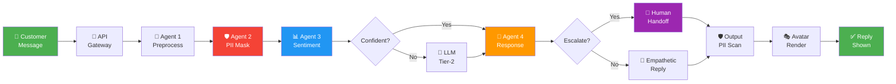

<p align="center">
  
</p>

<h1 align="center">🤖 Retail Customer Sentiment Analysis Chatbot</h1>

<p align="center">
  <em>Multi-agent AI chatbot with privacy-first PII masking, two-tier sentiment classification,<br/>empathetic response generation, and a sentiment-adaptive avatar</em>
</p>

<p align="center">
  
  
  
  
  
  
</p>

<p align="center">
  
  
  
  
</p>

---

<table>
<tr>
<td width="100%">

> **📍 TCS Technology Day Hackathon**
> <br/>M.S. Sheshgiri College of Engineering & Technology, Belagavi, Karnataka
> <br/>**🗓️ October 2026**

</td>
</tr>
</table>

---

## 🎯 Problem Statement

Build a chatbot that **engages retail customers**, **detects sentiment in real time**, and **generates contextually appropriate empathetic responses or recommends escalation** — achieving **80%+ sentiment classification accuracy** with full **data anonymization and compliance**.

---

## ✨ Key Differentiators

<table>
<tr>
<td width="50%">

### 🔒 Privacy by Design
Dedicated PII masking agent with **layered detection** — regex validators with checksum (Luhn, Aadhaar), Microsoft Presidio NER, and custom Indian-format recognizers (PAN, UPI, IFSC, +91 mobile). Encrypted vault with TTL. **Fail-closed**: if masking fails, no external model sees the text.

</td>
<td width="50%">

### 🧠 Two-Tier Sentiment Analysis
**Tier 1** (every message): Cardiff RoBERTa polarity + emotion DistilRoBERTa + rule-based escalation signals. **Tier 2** (hard cases only): LLM structured review triggered by low confidence, sarcasm, model disagreement, or declining trend.

</td>
</tr>
<tr>
<td width="50%">

### 🎭 Sentiment-Adaptive Avatar
Avatar expression, voice tone, and pace **adapt to detected emotion** — concerned and calm for angry customers, warm smile for happy ones. Confidence-based smoothing prevents jarring transitions.

</td>
<td width="50%">

### 📋 Explainable Escalation
Rule-based triggers combined with model confidence produce **transparent handoff packages** — case summary, sentiment trend, policy references, and vault reference for authorized humans. No black-box decisions.

</td>
</tr>
</table>

---

## 🏗️ Architecture

```
┌──────────────────────────────────────────────────────────────────┐
│  CLIENT: React Chat UI · Avatar Panel · Privacy Panel · Dashboard │
└──────────────────────────────┬───────────────────────────────────┘
                               │ REST / SSE
┌──────────────────────────────▼───────────────────────────────────┐
│  API GATEWAY (FastAPI): validation · request ID · rate limit      │
└──────────────────────────────┬───────────────────────────────────┘
                               │
┌──────────────────────────────▼───────────────────────────────────┐
│  ORCHESTRATOR: shared state · conditional routing · fail-closed   │
└───┬──────────────┬───────────────┬───────────────┬──────────────┘
    │              │               │               │
    ▼              ▼               ▼               ▼
┌────────┐  ┌───────────┐  ┌───────────┐  ┌──────────────────┐
│ Agent 1 │  │  Agent 2   │  │  Agent 3   │  │     Agent 4      │
│ Pre-    │→ │  Privacy   │→ │ Sentiment  │→ │ Response +       │
│ process │  │  (PII)     │  │ Analysis   │  │ Escalation +     │
│         │  │            │  │            │  │ Avatar           │
└────────┘  └─────┬──────┘  └─────┬──────┘  └────────┬─────────┘
                  │               │                   │
                  ▼               ▼                   ▼
           ┌──────────┐   ┌────────────┐     ┌──────────────┐
           │ Encrypted │   │ RoBERTa ·  │     │ LLM · Policy │
           │ PII Vault │   │ Emotion ·  │     │ KB (RAG) ·   │
           │           │   │ VADER · LLM│     │ TTS/Avatar   │
           └──────────┘   └────────────┘     └──────────────┘
```

### Pipeline Flow



---

## 🛠️ Tech Stack

<table>
<tr><th>Layer</th><th>Technology</th></tr>
<tr><td><strong>Frontend</strong></td><td>React 19 · Vite · Tailwind CSS · Lucide Icons · Motion · Three.js (R3F)</td></tr>
<tr><td><strong>Backend</strong></td><td>Python 3.14 · FastAPI · Pydantic v2 · SQLAlchemy (async) · structlog</td></tr>
<tr><td><strong>PII Detection</strong></td><td>Microsoft Presidio · spaCy · Custom regex (Aadhaar, PAN, UPI, IFSC)</td></tr>
<tr><td><strong>Sentiment Models</strong></td><td>Cardiff RoBERTa · Emotion DistilRoBERTa · VADER (baseline)</td></tr>
<tr><td><strong>LLM Providers</strong></td><td>Google Gemini (primary) · Groq Llama 3.2 (local fallback)</td></tr>
<tr><td><strong>RAG</strong></td><td>SQLite FTS5 full-text search · TF-overlap reranking</td></tr>
<tr><td><strong>Storage</strong></td><td>SQLite (WAL mode) · Encrypted PII vault (Fernet)</td></tr>
<tr><td><strong>Avatar</strong></td><td>React AI Avatar · VRM/GLB · WebAudio AnalyserNode</td></tr>
<tr><td><strong>Observability</strong></td><td>Structured logging (structlog) · per-request tracing</td></tr>
</table>

---

## 🚀 Quick Start

### Prerequisites

- Python 3.11+
- Node.js 18+
- API key for Google Gemini or Groq (see [`.env.example`](.env.example))

### Backend

```bash
# Clone
git clone https://github.com/VAIBHAV7848/TCS-Retail-Sentiment-Chatbot.git
cd TCS-Retail-Sentiment-Chatbot

# Virtual environment
python -m venv .venv
source .venv/bin/activate    # Linux/macOS
# .venv\Scripts\activate     # Windows

# Dependencies
pip install -r requirements.txt
python -m spacy download en_core_web_sm

# Configure
cp .env.example .env
# → Edit .env with your GROQ_API_KEY or GEMINI_API_KEY

# Index the policy knowledge base
python scripts/ingest_policies.py

# Start server
uvicorn app.main:app --reload --host 0.0.0.0 --port 8000
```

### Frontend

```bash
cd frontend
npm install
npm run dev
```

Open **http://localhost:5173** — the chat UI connects to the backend at port 8000.

---

## 📡 API Reference

| Endpoint | Method | Description |
|:---|:---:|:---|
| `/chat` | `POST` | Single message → full agent pipeline → reply + sentiment + avatar |
| `/chat/stream` | `POST` | SSE streaming variant of `/chat` |
| `/chat/human/handoff` | `POST` | Transfer session from AI to live human representative |
| `/chat/human/send` | `POST` | Bidirectional messaging within human-in-the-loop chat |
| `/chat/sessions/{id}/messages` | `GET` | Full chronological conversation transcript |
| `/chat/human/active-sessions` | `GET` | Human agent queue with open cases |
| `/dashboard/summary` | `GET` | Sentiment distribution, trends, escalation stats |
| `/cases/{id}` | `GET` | View escalated case (masked) |
| `/privacy/preview` | `POST` | Demo: raw text vs masked text comparison |
| `/session/{id}` | `DELETE` | Delete session data and vault entries |
| `/health` | `GET` | Health check and model status |

---

## 📂 Project Structure

```
📦 TCS-Retail-Sentiment-Chatbot
├── 📁 app/
│   ├── 📁 agents/             # The 4 pipeline agents
│   │   ├── preprocess_agent.py    # Agent 1: text cleanup
│   │   ├── privacy_agent.py       # Agent 2: PII masking
│   │   ├── sentiment_agent.py     # Agent 3: sentiment analysis
│   │   ├── response_agent.py      # Agent 4: response generation
│   │   ├── escalation.py          # Agent 4: escalation rules
│   │   └── avatar_controller.py   # Agent 4: avatar directives
│   ├── 📁 api/                # FastAPI route handlers
│   ├── 📁 core/               # Config and Pydantic schemas
│   ├── 📁 data/               # SQLAlchemy models and repositories
│   ├── 📁 model_gateway/      # LLM provider abstraction + fallback
│   ├── 📁 observability/      # Request tracing and metrics
│   ├── 📁 orchestration/      # Pipeline graph, routing, state
│   ├── 📁 privacy/            # PII masker, vault, output scan
│   │   ├── recognizers_india.py   # Aadhaar, PAN, UPI, +91, IFSC
│   │   ├── masker.py              # Layered detection engine
│   │   ├── vault.py               # Encrypted PII storage
│   │   └── output_scan.py        # Response PII re-check
│   ├── 📁 retrieval/          # Lightweight RAG (FTS5 + rerank)
│   └── 📁 sentiment/          # Polarity, emotion, rules, LLM tier-2
├── 📁 frontend/
│   └── 📁 src/
│       ├── 📁 components/     # Chat, Avatar, Dashboard, Privacy, HumanAgentDesk
│       └── 📁 hooks/          # useChat with streaming + handoff
├── 📁 data/policies/          # Retail policy docs for RAG
├── 📁 scripts/                # Policy ingestion utility
├── 📁 tests/                  # Unit and integration tests
├── 📁 docs/                   # Architecture decisions
├── 📄 requirements.txt
├── 📄 .env.example
└── 📄 .gitignore
```

---

## 🎬 Demo Scenarios

| # | Scenario | What Happens |
|:---:|:---|:---|
| 1 | 😊 **Happy customer** — praises a product | Warm avatar smile, short appreciative reply |
| 2 | 🤔 **Neutral question** — asks about return policy | Attentive avatar, grounded answer with policy citation |
| 3 | 😤 **Frustrated customer** — delayed order | Concerned avatar, empathetic reply with next steps |
| 4 | 🔥 **Angry repeat complaint** — demands refund | Calm avatar, **escalation** with full handoff package |
| 5 | 🔐 **PII scenario** — pastes phone + card number | Before/after masking panel shown, privacy warning |
| 6 | 😏 **Sarcasm** — "Great, another delay." | Tier-2 LLM catches sarcasm, appropriate response |
| 7 | 👤 **Human handoff** — customer asks for a person | Session transferred to Human Agent Desk |

---

## 📊 Success Metrics

| Metric | Target |
|:---|:---|
| Sentiment accuracy (3-class) | **80%+** on masked test set |
| PII detection recall | **High recall** (missed entity = data leak) |
| Response grounding | Claims supported by policy sources |
| End-to-end latency | p95 under 3s for tier-1 path |
| Tier-2 trigger rate | Logged and optimized for cost |

---

## 🔒 Security & Privacy

- **Fail-closed PII pipeline** — if masking errors, no external model sees text
- **Encrypted vault** — placeholder-to-value mapping encrypted with Fernet, separate DB, short TTL
- **Output scanning** — every response re-checked before display
- **No raw PII in logs** — all logging uses masked text only
- **No autonomous actions** — refunds/credits only *recommended*, never executed
- **Prompt injection defense** — user text treated as data, never as instructions

---

<p align="center">
  <strong>Built with ❤️ at M.S. Sheshgiri College of Engineering & Technology, Belagavi</strong>
  <br/>
  <sub>TCS Technology Day Hackathon · October 2026</sub>
</p>
