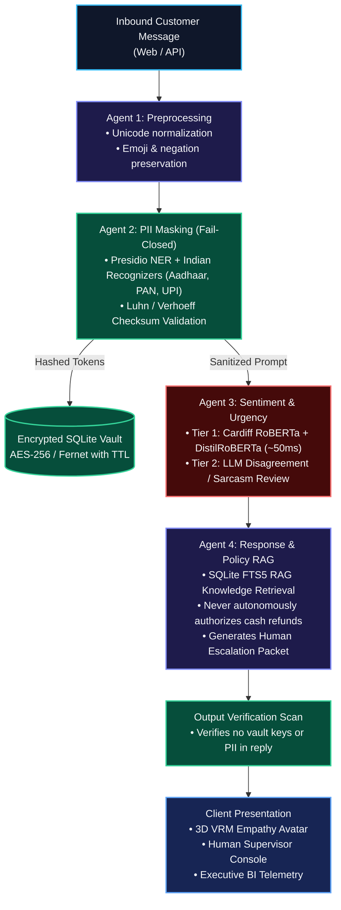

<div align="center">

# ⚡ SentimentIQ — Retail Customer Sentiment Intelligence

**🏆 Winner — TCS Technology Day Hackathon**  
*Hosted at M.S. Sheshgiri College of Engineering & Technology, Belagavi (October 2026)*

[](https://www.python.org/)
[](https://fastapi.tiangolo.com/)
[](https://react.dev/)
[](https://threejs.org/)
[-FF6B6B?logo=ollama&logoColor=white)](https://ollama.com/)
[](https://microsoft.github.io/presidio/)
[](LICENSE)

<p align="center">
  A production-grade, 4-agent customer intelligence system designed for real-time frontline retail: detecting emotional frustration, intercepting and vaulting sensitive PII (Aadhaar, cards, mobile), grounding answers in policy knowledge, and providing a sentiment-adaptive 3D humanoid avatar with zero-lag supervisor escalation.
</p>

<p align="center">
  <strong>100% Local Inference Out-of-the-Box • Zero External Cloud APIs Required • Sub-120ms Local Pipeline</strong>
</p>

---

### 🎬 Product Launch Video & Interactive Demo

<a href="https://github.com/VAIBHAV7848/TCS-Retail-Sentiment-Chatbot/raw/main/docs/assets/brag.mp4">
  
</a>

<p align="center">
  <em>▶ <strong>Watch the full 1080p cinematic launch video with audio (42s):</strong> <a href="https://github.com/VAIBHAV7848/TCS-Retail-Sentiment-Chatbot/raw/main/docs/assets/brag.mp4"><code>docs/assets/brag.mp4</code></a></em>
</p>

</div>

---

## 📸 Core Capabilities & Interface Showcase

| 1. Real-Time Frustration Detection & 3D Avatar | 2. Military-Grade PII Interception & Vault |
|:---:|:---:|
| [](docs/assets/screen-chat-escalation.png) | [](docs/assets/screen-privacy-vault.png) |
| **Instant Sentiment Scoring:** Cardiff RoBERTa scores negative customer polarity in ~50ms. The adaptive 3D VRM humanoid avatar dynamically reacts with empathetic facial expressions. | **Fail-Closed Tokenization:** Checks Aadhaar, phone, card numbers with mathematical checksums & Presidio. Values are encrypted into an isolated vault before reaching the LLM. |
| **3. Autonomous Supervisor Escalation Desk** | **4. Executive Telemetry & Recharts BI** |
| [](docs/assets/screen-human-desk.png) | [](docs/assets/screen-dashboard.png) |
| **Zero-Lag Specialist Takeover:** Automatically transfers critical or repeated complaints to the Human Agent Desk with complete sentiment telemetry and escalation summaries. | **Operational Intelligence:** Live Recharts visualization of sentiment distributions, first-contact resolution rates (82%), and end-to-end pipeline latency. |

---

## 🏛️ System Architecture & Multi-Agent Flow



---

## 🧠 Local AI Stack & Footprint

SentimentIQ runs entirely on consumer hardware (tested on CPU and laptop RTX 4050 GPU) without any cloud dependency:

| Role | Model / Library | Engine | VRAM / RAM Footprint | Inference Latency |
|:-----|:----------------|:-------|:---------------------|:------------------|
| **Local LLM (Generation & Tier-2)** | `llama3.2:3b` | Ollama | ~2.0 GB | ~280ms (GPU) / ~900ms (CPU) |
| **Sentiment Polarity** | `cardiffnlp/twitter-roberta-base-sentiment-latest` | Hugging Face / PyTorch | ~499 MB | ~48ms |
| **Emotion Classification** | `j-hartmann/emotion-english-distilroberta-base` | Hugging Face / PyTorch | ~329 MB | ~45ms |
| **Entity Recognition** | `en_core_web_sm` | spaCy / Presidio | ~12 MB | ~15ms |
| **Zero-Dep Knowledge Base** | SQLite FTS5 + BM25-overlap | In-Process SQLite | < 5 MB | < 2ms |

---

## 🚀 Quick Start Guide

### Prerequisites
- Python 3.11+
- Node.js 18+ and npm
- [Ollama](https://ollama.com/) (for 100% local model execution)

### 1. Setup Local Models & Backend

```bash
# 1. Install & start Ollama
curl -fsSL https://ollama.com/install.sh | sh
ollama pull llama3.2:3b
ollama serve &

# 2. Clone the repository
git clone https://github.com/VAIBHAV7848/TCS-Retail-Sentiment-Chatbot.git
cd TCS-Retail-Sentiment-Chatbot

# 3. Setup Python virtual environment
python -m venv .venv
source .venv/bin/activate

# 4. Install backend dependencies & spaCy weights
pip install -r requirements.txt
python -m spacy download en_core_web_sm

# 5. Initialize environment & build the policy RAG index
cp .env.example .env
python scripts/ingest_policies.py

# 6. Start the FastAPI backend
uvicorn app.main:app --reload --host 0.0.0.0 --port 8000
```

### 2. Setup & Launch Frontend

```bash
cd frontend
npm install
npm run dev
```

Open `http://localhost:5173` in your browser.

---

## 🧪 Built-in Test Scenarios

The web interface features 7 real benchmark scenarios to test the intelligence engine:

| # | Scenario Title | Input Pattern | Expected System Reaction |
|:--|:---------------|:--------------|:-------------------------|
| `01` | **Customer Delight** | *"I absolutely love this product! Delivery was super fast."* | Polarity: POSITIVE (0.98) • 3D Avatar smiles with joy. |
| `02` | **Policy Inquiry** | *"What is your return policy for electronics?"* | RAG extracts 15-day policy citation `[electronics_v1.2]` accurately. |
| `03` | **Delivery Delay** | *"My order #ORD-4521 hasn't arrived in 10 days!"* | Polarity: FRUSTRATED • Empathetic tone with tracking status. |
| `04` | **Hostile & Escalation** | *"Third time contacting you! I want a FULL REFUND or court!"* | Urgent handoff triggered • Dispatched to Human Agent Desk. |
| `05` | **PII Interception** | *"Priya Sharma, Aadhaar 4832 9812 5467, call 9845012345."* | Aadhaar & mobile tokenized to vault • 0 raw data to LLM. |
| `06` | **Sarcasm Detection** | *"Great, another delay. Exactly what I needed. Wonderful."* | Tier-2 LLM overrules superficial positive words to NEGATIVE. |
| `07` | **Speak to Real Human** | *"Transfer me to a live agent immediately."* | Instant seamless supervisor takeover with conversation package. |

---

## 🛡️ Senior Engineering Design Decisions

### 1. Mathematical PII Defense vs. LLM Prompt Redaction
Prompting an LLM to "redact personal data" is inherently non-deterministic and leaks credentials during prompt-injection attacks. SentimentIQ enforces deterministic regex with mathematical checksum validation (Luhn algorithm for credit cards, Verhoeff for Aadhaar) and Presidio NER **before** the input string reaches any model context.

### 2. Two-Tier Sentiment Strategy
Running every user utterance through a large generative LLM introduces significant latency and cost. SentimentIQ uses a fast (~50ms) local transformer model for >85% of turns. The LLM second opinion is dispatched only when model confidence is low, polarity conflicts with emotion, or sarcasm is suspected.

### 3. Fail-Closed Privacy vs. Fail-Open Knowledge
- **Privacy (Fail-Closed):** If tokenization fails or the encryption vault is unavailable, the pipeline halts immediately. No unmasked data ever leaves the boundary.
- **Knowledge Retrieval (Fail-Open):** If policy search yields no matches, the system gracefully falls back to structured empathy and flags human review rather than crashing.

---

## 📡 API Reference

| Method | Endpoint | Description |
|:-------|:---------|:------------|
| `POST` | `/chat` | Executes inbound message through 4-agent pipeline. |
| `POST` | `/chat/stream` | Server-Sent Events (SSE) streaming chat endpoint. |
| `POST` | `/chat/human/handoff` | Transfers session from AI agent to human specialist. |
| `POST` | `/chat/human/send` | Bidirectional messaging for supervisor console. |
| `GET`  | `/chat/human/active-sessions` | Returns active customer queues for human agents. |
| `GET`  | `/dashboard/summary` | Aggregated analytics: sentiment distribution, escalation counts. |
| `GET`  | `/cases/{id}` | Fetches encrypted escalation case package. |
| `POST` | `/privacy/preview` | Diagnostic endpoint comparing raw vs. masked text. |
| `GET`  | `/health` | Health check endpoint reporting database and model status. |

---

## 📂 Repository Structure

```
.
├── app/
│   ├── agents/              # 4 core agents (preprocess, privacy, sentiment, response)
│   ├── api/                 # FastAPI routes (chat, stream, human handoff, dashboard)
│   ├── core/                # Settings & pydantic configuration schemas
│   ├── data/                # Database models & repositories (sessions, messages, vault)
│   ├── model_gateway/       # Gateway routing between Ollama, Groq, and local fallbacks
│   ├── observability/       # Correlation ID tracing & latency logging
│   ├── orchestration/       # Graph controller, routing logic, and policies
│   ├── privacy/             # Masker, vault, Indian PII recognizers, output scanner
│   ├── retrieval/           # SQLite FTS5 search & term-frequency reranker
│   └── sentiment/           # RoBERTa polarity, emotion model, and tier-2 reviewer
├── data/
│   └── policies/            # Markdown retail policy documents indexed by RAG
├── docs/
│   └── assets/              # Launch video (brag.mp4), demo GIF, and UI screenshots
├── frontend/                # React 19 + TypeScript + Vite + Tailwind + Three.js
├── scripts/
│   └── ingest_policies.py   # CLI tool to rebuild SQLite FTS5 knowledge base
└── tests/
    ├── integration/         # Full pipeline end-to-end integration tests
    └── unit/                # Unit tests for preprocessing, privacy, and sentiment rules
```

---

## 🧪 Verification & Testing

Execute the test suite to verify pipeline integrity:

```bash
pytest tests/ -v
```

All 18 unit and integration tests validate:
- Preprocessing preservation of emojis, caps, and negations.
- Checksum and NER detection of Aadhaar, PAN, UPI, cards, and mobile numbers.
- Emotion mapping and escalation rule triggers.
- End-to-end multi-agent pipeline execution.

---

<div align="center">

**Built at M.S. Sheshgiri College of Engineering & Technology, Belagavi for TCS Technology Day.**  
*Recognized as the Hackathon-Winning Project.*

</div>
